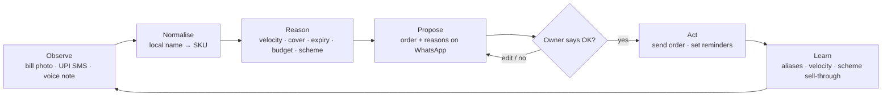
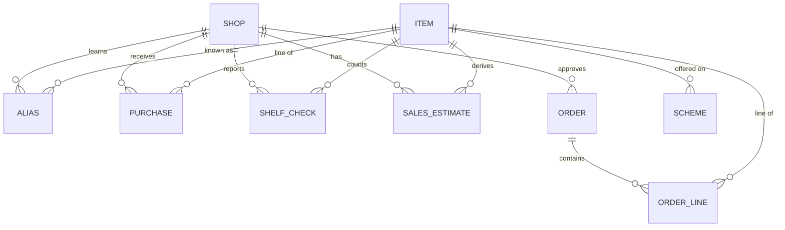

# Munshi

**A WhatsApp agent that keeps a kirana's cash out of dead stock — without the owner typing a single sale.**

Team Degen · Mohammed Amees · Girish Kumara M
GAVS Hackathon · Theme: Rural FMCG and logistics · Problem 5.1 · Agentic AI track

> *Munshi* is the clerk every kirana used to have: the person who read the bills, kept the ledger and had tomorrow's order ready before the salesman walked in.

---

## The problem, and the insight

Kiranas lose 15–20% of working capital to dead stock and see ₹5,000–10,000 of stock expire every month, while the items that actually sell run out. Most shops have no billing system, so there is nothing to learn from (problem brief 5.1).

Our read: **dead stock is a cash-allocation problem, not a memory problem.** Two things decide what a shop buys, and no inventory app models either:

1. **The salesman's scheme.** "Buy 12, get 1 free" turns one month of stock into three. The free pack is paid for twice — in cash locked on the shelf and in packs that expire before they sell.
2. **Customer udhaar.** Credit given to regulars sits in the khata. That cash cannot buy the fast movers that ran out yesterday.

Inventory apps also need the owner to type in every sale, which is why they die within a week. Munshi never asks the owner to enter a sale.

## What Munshi does

- Reads what the shop already produces: distributor bill photos, UPI payment SMS alerts, and a 30-second voice shelf check in Kannada or Hindi.
- Maintains a stock ledger per item: velocity, days of cover, expiry risk in rupees.
- On the morning the salesman is due, proposes an order capped at the cash budget the owner sets, adjusted for expected udhaar collections.
- Evaluates every scheme against real velocity and refuses the ones that lock up cash, or proposes splitting the lot with a neighbouring shop.
- Flags stock that will expire before it sells, with an action: move to the counter, bundle, or return to the distributor before the return window closes.
- Forecasts festival demand from a locality cohort plus a regional festival calendar, so a new shop gets a usable forecast on day one — with a confidence band on every number.
- **Acts only after the owner replies OK.**

---

## Architecture: the agent loop



| Stage | What happens | Tools called |
|---|---|---|
| Observe | A bill photo, a UPI SMS or a voice note arrives on WhatsApp | `parse_bill`, speech-to-text |
| Normalise | Each item name is mapped to a canonical SKU using the shop's own alias memory | `normalise_item`, `ask_owner` |
| Reason | The ledger is updated; velocity, days of cover, expiry risk and the cash budget are recomputed; every open scheme is evaluated | `update_stock`, `score_expiry`, `evaluate_scheme` |
| Propose | A budget-capped order list with a one-line reason per item is sent to the owner | `draft_order`, `pool_with_neighbour` |
| Owner approves | The owner replies OK or edits the list. Nothing proceeds without this step | — |
| Act | The order goes to the distributor; return-window and expiry reminders are scheduled | `send_order`, `schedule_reminder` |
| Learn | Confirmed aliases, actual sell-through of schemes and corrected counts update the shop's model | `update_stock`, alias memory |

### Tools

```
parse_bill(image)                              -> Purchase[]            # LLM vision, strict JSON
normalise_item(phrase, shop)                   -> {sku, confidence, question}
update_stock(shop, events[])                   -> Ledger
score_expiry(shop)                             -> ExpiryRisk[]          # ₹ at risk + action per item
draft_order(shop, budget)                      -> Order                 # greedy by velocity × margin
evaluate_scheme(scheme, item, velocity)        -> Verdict               # take / skip / pool
pool_with_neighbour(order_line, nearby_shops)  -> PoolProposal
ask_owner(question)                            -> yes | no | text       # one yes/no question at a time
send_order(order, distributor)                 -> Receipt               # only after owner approval
schedule_reminder(shop, item, date, reason)    -> Reminder
```

### Guardrails (taken from the brief's *Boundaries*)

- Purchases are capped at the cash budget the owner sets.
- The owner approves every order. There is no auto-ordering path in the code.
- Every forecast carries a confidence band; the agent states what it does not know.
- Shop data leaves the shop only as anonymised locality aggregates.
- The agent asks at most three yes/no questions a day, so it stays useful within a week instead of becoming a chore.

---

## Decision rules

All rules are plain arithmetic over the ledger; the LLM is used for reading and talking, not for the numbers.

```
velocity          = (units_in − Δ shelf_count) / days_in_window          # units per day
days_of_cover     = on_hand / velocity
expiry_ratio      = days_to_expiry / days_of_cover                        # < 1 ⇒ will expire on the shelf
rupees_at_risk    = max(0, on_hand − velocity × days_to_expiry) × unit_cost

budget            = cash_on_hand + expected_udhaar_collections − commitments
draft_order       : sort items by velocity × margin, buy up to target_cover (default 7 days)
                    until budget is exhausted; slow movers below a velocity floor are skipped

scheme evaluator  :
  saving          = free_units × unit_price
  cash_locked     = paid_units × unit_price
  cover_days      = (paid_units + free_units) / velocity
  verdict         = SKIP  if cover_days > shelf_life_days or cover_days > 2 × target_cover
                  = POOL  if a neighbouring shop's demand brings cover_days under the threshold
                  = TAKE  otherwise
```

Worked example: item at ₹50, sells 6 a month, scheme is buy 12 get 1 free. Saving ₹50; cash locked ₹600 for about 65 days; expiry likely if shelf life is under 65 days → **SKIP, or split the 12 with a neighbouring shop.**

---

## Data model



| Entity | Fields | Notes |
|---|---|---|
| **Shop** | `shop_id`, `owner_phone`, `language`, `cash_budget`, `locality`, `distributors[]` | One row per kirana; `cash_budget` is set and changed only by the owner |
| **Item** | `sku_id`, `canonical_name`, `pack_size`, `category`, `shelf_life_days`, `margin_pct` | Shared catalogue; seeded with the top ~500 kirana SKUs |
| **Alias** | `shop_id`, `phrase`, `sku_id`, `confidence`, `last_confirmed` | Per-shop vocabulary: "biscuit chhota" → Parle-G ₹5 pack. Grows with every bill and voice note |
| **Purchase** | `shop_id`, `bill_id`, `sku_id`, `qty`, `unit_price`, `batch`, `expiry`, `scheme_terms`, `received_on` | One row per bill line, produced by `parse_bill` |
| **ShelfCheck** | `shop_id`, `sku_id`, `count` or `status`, `source`, `checked_on` | From a voice note (`"Maggi khatam"` → status `sold_out`) or a yes/no reply |
| **SalesEstimate** | `shop_id`, `sku_id`, `velocity_per_day`, `days_of_cover`, `confidence`, `computed_on` | Derived, recomputed after every event |
| **Order** | `order_id`, `shop_id`, `distributor`, `proposed_on`, `status`, `budget_cap`, `budget_used` | `status` ∈ proposed → edited → approved → sent. Only `approved` can become `sent` |
| **OrderLine** | `order_id`, `sku_id`, `qty`, `reason`, `scheme_verdict` | `reason` is the one-line explanation shown to the owner |
| **Scheme** | `scheme_id`, `distributor`, `sku_id`, `buy_n`, `free_m`, `valid_till`, `verdict`, `sell_through` | `sell_through` is filled in later, so the evaluator learns which schemes actually worked |

Locality aggregates (for festival priors and the distributor demand report) are computed from `SalesEstimate` grouped by `locality` and `category`, never joined back to a `shop_id`.

---

## Prompts

### 1. Bill extraction

Input: one photo of a distributor bill. Output: strict JSON. Application-side check: the sum of `line_total` must reconcile with `bill_total` within 1%; on mismatch the call is retried once with the mismatch described, and if it still fails the owner is asked to confirm the total.

```text
You are reading a photo of a distributor bill issued to a small Indian kirana shop.
Extract every line item. Return ONLY a JSON object matching this schema. No prose,
no markdown fences.

{
  "distributor": string | null,
  "bill_date": "YYYY-MM-DD" | null,
  "bill_total": number | null,
  "items": [
    {
      "name": string,                 // exactly as printed, do not normalise
      "qty": number,                  // paid units only
      "unit": string | null,          // "pc", "pkt", "kg", "ltr", "box" ...
      "unit_price": number | null,
      "line_total": number | null,
      "batch": string | null,
      "expiry": "YYYY-MM" | "YYYY-MM-DD" | null,
      "scheme": string | null,        // e.g. "12+1" if free units are shown
      "confidence": number            // 0 to 1, for this line
    }
  ]
}

Rules:
- Copy item names exactly as printed. Do not expand abbreviations or guess brands.
- Free or bonus quantities belong in "scheme", never in "qty".
- If a field is unreadable, set it to null and lower that line's confidence.
- The sum of line_total should equal bill_total. If it does not, re-read the bill
  before answering; do not invent a line to make it balance.
- Dates printed as MM/YY are expiry dates in "YYYY-MM" form.
```

### 2. Name normalisation

Input: the owner's phrase (transcribed from a voice note or typed), this shop's alias memory, and the top-50 catalogue entries for the shop. Output: strict JSON. Application-side rule: if `confidence < 0.8`, the SKU is not written to the ledger; the `question` is sent to the owner instead, and a "yes" writes the alias so the question is never asked again.

```text
You map what a kirana owner says into one canonical SKU from this shop's catalogue.
The phrase may mix Kannada, Hindi and English and may contain a quantity or a status
("khatam" = sold out, "do bache" = two left).

Shop alias memory (owner phrase -> SKU), highest priority:
{aliases}

Shop catalogue (sku_id, canonical_name, pack_size):
{catalogue}

Owner phrase:
"{phrase}"

Return ONLY this JSON, no prose:
{
  "sku_id": string | null,
  "sku_name": string | null,
  "qty": number | null,
  "action": "sold_out" | "count" | "running_low" | "unknown",
  "confidence": number,             // 0 to 1
  "question": string | null         // one yes/no question in the owner's language
}

Rules:
- An alias match always beats a catalogue guess.
- Never return a SKU that is not in the catalogue. If nothing fits, return null.
- If confidence is below 0.8, set sku_id to null and write ONE short yes/no
  question naming the most likely SKU, e.g. "Maggi 70g khatam?".
- Pack size matters: "maggi bada" is not the same SKU as "maggi chhota".
```

---

## Useful within a week

| Day | What happens | Owner's effort |
|---|---|---|
| 1 | Five recent bill photos + one voice shelf walk. The ledger exists by evening | ~10 minutes |
| 2–6 | Three yes/no questions a day. Velocity and the expiry picture fill in | ~1 minute a day |
| 7 | First order proposed within budget and approved. First expiry rescue | ~3 minutes |

KPIs: rupees of expiring stock caught · stockouts avoided on the top-20 items · minutes per order.

## Stack

- LLM API with vision for `parse_bill`, text for `normalise_item` and the owner-facing messages
- Postgres (SQLite for the prototype) for the ledger
- WhatsApp Cloud API in production; Twilio sandbox or a web chat mock for the demo
- Speech-to-text for Kannada and Hindi voice notes
- Plain Python for every decision rule — no model in the arithmetic

## Repository layout (planned)

```
munshi/
├── README.md
├── prompts/
│   ├── bill_extraction.md
│   └── name_normalisation.md
├── src/
│   ├── tools/            # parse_bill, normalise_item, update_stock, score_expiry,
│   │                     # draft_order, evaluate_scheme, pool_with_neighbour, ask_owner
│   ├── rules.py          # velocity, cover, expiry ratio, budget, scheme evaluator
│   ├── agent.py          # the observe → learn loop with the approval gate
│   └── whatsapp.py       # inbound/outbound messages
├── data/
│   ├── catalogue.csv     # seed SKUs with pack sizes and shelf life
│   └── festivals.csv     # regional festival calendar
└── tests/
    └── test_rules.py     # the worked scheme example is the first test
```

## Who pays

The shop never does. Catching 20–30% of the ₹5,000–10,000 that expires monthly saves a shop ₹1,000–3,000 a month, which is why adoption sticks. Distributors and FMCG brands pay for locality-level, next-week demand per beat — which they currently get from a salesman's gut. The distributor's salesman, who already visits every shop weekly, is the onboarding channel.

## Roadmap

- **30 days** — 10 shops on one distributor beat; the three KPIs proven in the field
- **90 days** — 100 shops; first paid locality demand report to a distributor
- **180 days** — second city; first FMCG brand pilot on festival planning

## What we deliberately do not build

No POS. No mandatory barcodes. No dashboard. No auto-ordering. No forecasting from a single shop's data.
