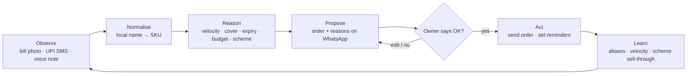
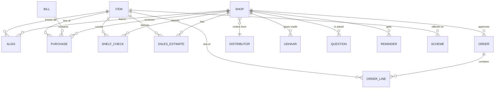

# Munshi

**A WhatsApp agent that keeps a kirana's cash out of dead stock — without the owner typing a single sale.**

Team Degen · Mohammed Amees · Girish Kumara M
GAVS Hackathon · Theme: Rural FMCG and logistics · Problem 5.1 · Agentic AI track

> *Munshi* is the clerk every kirana used to have: the person who read the bills, kept the ledger and had tomorrow's order ready before the salesman walked in.

---

## The problem, and the insight

Kiranas lose 15–20% of working capital to dead stock and see ₹5,000–10,000 of stock expire every month, while the items that actually sell run out. Most shops have no billing system, so there is nothing to learn from (problem brief 5.1).

Our read: **dead stock is a cash-allocation problem, not a memory problem.** Two things decide what a shop buys, and no inventory app models either:

1. **The salesman's scheme.** "Buy 12, get 1 free" turns one month of stock into three. The free pack is paid for twice — in cash locked on the shelf and in packs that expire before they sell.
2. **Customer udhaar.** Credit given to regulars sits in the khata. That cash cannot buy the fast movers that ran out yesterday.

Inventory apps also need the owner to type in every sale, which is why they die within a week. Munshi never asks the owner to enter a sale.

## What Munshi does

- Reads what the shop already produces: distributor bill photos, UPI payment SMS alerts the owner forwards, and a 30-second voice shelf check in Kannada, Hindi or English.
- Maintains a stock ledger per item: velocity, days of cover, expiry risk in rupees.
- On the morning the salesman is due, proposes an order capped at the cash budget the owner sets, adjusted for expected udhaar collections.
- Evaluates every scheme against real velocity and refuses the ones that lock up cash, or proposes splitting the lot with a neighbouring shop.
- Flags stock that will expire before it sells, with an action: move to the counter, bundle, or return to the distributor before the return window closes.
- Forecasts festival demand from a regional festival calendar and category uplifts, with a confidence band on every number, and adds the extra to the order for festival week. A new shop's sales rates come from nearby Munshi shops until its own history builds up.
- **Acts only after the owner replies OK.**

---

## Architecture: the agent loop



| Stage | What happens | Tools called |
|---|---|---|
| Observe | A bill photo, a UPI SMS or a voice note arrives on WhatsApp | `parse_bill`, speech-to-text |
| Normalise | Each item name is mapped to a canonical SKU using the shop's own alias memory | `normalise_item`, `ask_owner` |
| Reason | The ledger is updated; velocity, days of cover, expiry risk and the cash budget are recomputed; every open scheme is evaluated | `update_stock`, `score_expiry`, `evaluate_scheme` |
| Propose | A budget-capped order list with a one-line reason per item is sent to the owner | `draft_order`, `pool_with_neighbour` |
| Owner approves | The owner replies OK or edits the list. Nothing proceeds without this step | — |
| Act | The order goes to the distributor; return-window and expiry reminders are scheduled | `send_order`, `schedule_reminder` |
| Learn | Confirmed aliases, actual sell-through of schemes and corrected counts update the shop's model | `update_stock`, alias memory |

### Tools

```
parse_bill(image)                              -> Purchase[]            # LLM vision, strict JSON
normalise_item(phrase, shop)                   -> {sku, confidence, question}
update_stock(shop, events[])                   -> Ledger
score_expiry(shop)                             -> ExpiryRisk[]          # ₹ at risk + action per item
draft_order(shop, budget)                      -> Order                 # greedy by velocity × margin
evaluate_scheme(scheme, item, velocity)        -> Verdict               # take / skip / pool
pool_with_neighbour(order_line, nearby_shops)  -> PoolProposal
ask_owner(question)                            -> yes | no | text       # one yes/no question at a time
send_order(order, distributor)                 -> Receipt               # only after owner approval
schedule_reminder(shop, item, date, reason)    -> Reminder
```

Every tool call is written to a trace, so the operator console can show exactly what the agent did for each message.

### Guardrails (taken from the brief's *Boundaries*)

- Purchases are capped at the cash budget the owner sets.
- The owner approves every order. There is no auto-ordering path in the code.
- Every forecast carries a confidence band; the agent states what it does not know.
- Other shops and distributors see a shop's data only as locality aggregates, and only where at least 3 shops contribute. Splitting a scheme lot shares two shops' names and numbers only after both owners say yes. Bill photos and voice notes are sent to Claude and Sarvam to be read; forwarded UPI SMS keep amounts only, never names.
- The agent asks at most three yes/no questions a day, one at a time, so it stays useful within a week instead of becoming a chore. Extra questions wait for the next day.

---

## Decision rules

All rules are plain arithmetic over the ledger; the LLM is used for reading and talking, not for the numbers.

```
velocity          = (units_in − Δ shelf_count) / days_in_window          # units per day
days_of_cover     = on_hand / velocity
expiry_ratio      = days_to_expiry / days_of_cover                        # < 1 ⇒ will expire on the shelf
rupees_at_risk    = per batch, oldest stock sells first:
                    max(0, batch_units − (velocity × days_to_expiry − older_units)) × unit_cost

budget            = min(owner_cap, cash_on_hand + expected_udhaar_collections − commitments)
expected_udhaar   = Σ amount × chance it comes back this week
                    (given ≤7 days ago 60% · ≤30 days 40% · ≤60 days 15% · older 5%)
draft_order       : sort items by velocity × margin, buy up to target_cover (default 7 days)
                    until budget is exhausted; slow movers below a velocity floor are skipped;
                    if a festival falls inside the cover window, velocity × (1 + category uplift)

scheme evaluator  :
  saving          = free_units × unit_price
  cash_locked     = paid_units × unit_price
  cover_days      = (paid_units + free_units) / velocity
  verdict         = SKIP  if cover_days > shelf_life_days or cover_days > 2 × target_cover
                  = POOL  if a neighbouring shop's demand brings cover_days under the threshold
                  = TAKE  otherwise
  learned         : a TAKE becomes SKIP if this shop's earlier lots of the item sold under 70%
                    within 14 days of delivery (scheme.sell_through)
```

Worked example: item at ₹50, sells 6 a month, scheme is buy 12 get 1 free. Saving ₹50; cash locked ₹600 for about 65 days; expiry likely if shelf life is under 65 days → **SKIP, or split the 12 with a neighbouring shop.**

---

## Data model



| Entity | Fields | Notes |
|---|---|---|
| **Shop** | `shop_id` (the owner's WhatsApp number), `language`, `cash_budget`, `cash_on_hand`, `commitments`, `locality`, `salesman_day`, `distributor_id` | One row per kirana, created on its first WhatsApp message; `cash_budget` is set and changed only by the owner. One main distributor per shop for now |
| **Distributor** | `distributor_id`, `shop_id`, `name`, `phone`, `return_days_before_expiry` | Where approved orders go; the return window drives expiry reminders (default 15 days before expiry) |
| **Item** | `sku_id`, `shop_id`, `canonical_name`, `pack_size`, `category`, `shelf_life_days`, `unit_cost`, `mrp`, `case_qty` | Shared catalogue of 23 common SKUs (`data/catalogue.csv`, `shop_id` empty) plus items learned from each shop's bills (`shop_id` set). Margin is `mrp − unit_cost` |
| **Alias** | `shop_id`, `phrase`, `sku_id`, `confidence`, `last_confirmed` | Per-shop vocabulary: "biscuit chhota" → Parle-G ₹5 pack. Grows with every bill and voice note |
| **Bill** | `bill_id`, `shop_id`, `distributor`, `bill_date`, `bill_total`, `lines_total`, `reconciled` | One row per bill photo |
| **Purchase** | `shop_id`, `bill_id`, `sku_id`, `qty`, `free_qty`, `unit_price`, `mrp`, `batch`, `expiry`, `scheme_terms`, `received_on`, `status` | One row per bill line, produced by `parse_bill`; `status` is `pending` until an unknown name is confirmed |
| **ShelfCheck** | `shop_id`, `sku_id`, `count` or `status`, `source`, `checked_on` | From a voice note (`"Maggi khatam"` → status `sold_out`) or a yes/no reply |
| **SalesEstimate** | `shop_id`, `sku_id`, `velocity_per_day`, `band_low`, `band_high`, `days_of_cover`, `confidence`, `computed_on` | Derived, recomputed after every event |
| **Order** | `order_id`, `shop_id`, `distributor_id`, `proposed_on`, `status`, `budget_cap`, `budget_used`, `approval_text` | `status` ∈ proposed → edited → approved → sent, or `cancelled` when a newer proposal replaces it. Only `approved` can become `sent` |
| **OrderLine** | `order_id`, `sku_id`, `qty`, `free_qty`, `reason`, `scheme_verdict` | `reason` is the one-line explanation shown to the owner |
| **Scheme** | `scheme_id`, `distributor_id`, `sku_id`, `buy_n`, `free_m`, `valid_till`, `verdict`, `sell_through` | `sell_through` is filled in 14 days after a scheme lot arrives, so the evaluator learns which schemes actually worked |
| **Udhaar** | `shop_id`, `customer`, `amount`, `given_on`, `status` | Customer credit; feeds `expected_udhaar_collections` |
| **Question** | `shop_id`, `text`, `kind`, `status`, `answer` | `queued` → `open` (one at a time, at most three a day) → `answered` |
| **Reminder** | `shop_id`, `sku_id`, `due_on`, `reason`, `rupees` | Return-window reminders; `rupees` counts toward "expiring stock caught" |

Locality aggregates (for the distributor demand report) are computed from `SalesEstimate` grouped by `locality` and item, never joined back to a `shop_id`, and withheld unless at least 3 shops contribute. Festival uplifts by category start as estimates in `data/cohort.csv`, to be replaced by locality history as shops join.

---

## Prompts

The prompts live in `prompts/` and are sent as written, with the shop's data filled in. Calls use Claude's structured JSON output, so the reply always matches the schema.

### 1. Bill extraction

Input: one photo of a distributor bill. Output: strict JSON. Application-side check: the sum of `line_total` must reconcile with `bill_total` within 1%; on mismatch the call is retried once with the mismatch described, and if it still fails the owner is asked to confirm the total.

```text
You are reading a photo of a distributor bill issued to a small Indian kirana shop.
Extract every line item. Return ONLY a JSON object matching this schema. No prose,
no markdown fences.

{
  "distributor": string | null,
  "bill_date": "YYYY-MM-DD" | null,
  "bill_total": number | null,
  "discount": number | null,        // total discount line, if the bill shows one
  "tax": number | null,             // GST / tax line, if the bill shows one
  "items": [
    {
      "name": string,                 // exactly as printed, do not normalise
      "qty": number,                  // paid units only
      "unit": string | null,          // "pc", "pkt", "kg", "ltr", "box" ...
      "unit_price": number | null,
      "mrp": number | null,           // printed MRP per unit, if the bill shows it
      "line_total": number | null,
      "batch": string | null,
      "expiry": "YYYY-MM" | "YYYY-MM-DD" | null,
      "scheme": string | null,        // e.g. "12+1" if free units are shown
      "confidence": number            // 0 to 1, for this line
    }
  ]
}

Rules:
- Copy item names exactly as printed. Do not expand abbreviations or guess brands.
- Free or bonus quantities belong in "scheme", never in "qty".
- If a field is unreadable, set it to null and lower that line's confidence.
- The sum of line_total, minus "discount", plus "tax", should equal bill_total. If it
  does not, re-read the bill before answering; do not invent a line to make it balance.
- Dates printed as MM/YY are expiry dates in "YYYY-MM" form.
```

### 2. Name normalisation

Input: the owner's phrase (transcribed from a voice note or typed), this shop's alias memory, and the top-50 catalogue entries for the shop. Output: strict JSON. Application-side rule: if `confidence < 0.8`, the SKU is not written to the ledger; the `question` is sent to the owner instead, and a "yes" writes the alias so the question is never asked again. An exact alias match is resolved locally, without calling the model; a bill line that matches nothing becomes a new item for that shop.

```text
You map what a kirana owner says into one canonical SKU from this shop's catalogue.
The phrase may mix Kannada, Hindi and English and may contain a quantity or a status
("khatam" = sold out, "do bache" = two left).

Shop alias memory (owner phrase -> SKU), highest priority:
{aliases}

Shop catalogue (sku_id, canonical_name, pack_size):
{catalogue}

Owner phrase:
"{phrase}"

Return ONLY this JSON, no prose:
{
  "sku_id": string | null,
  "sku_name": string | null,
  "qty": number | null,
  "action": "sold_out" | "count" | "running_low" | "unknown",
  "candidate_sku_id": string | null, // the single most likely SKU, even below 0.8
  "confidence": number,             // 0 to 1
  "question": string | null         // one yes/no question in the owner's language
}

Rules:
- An alias match always beats a catalogue guess.
- Never return a SKU that is not in the catalogue. If nothing fits, return null.
- If confidence is below 0.8, set sku_id to null, put the most likely SKU in
  candidate_sku_id, and write ONE short yes/no question naming it, e.g. "Maggi 70g khatam?".
- Pack size matters: "maggi bada" is not the same SKU as "maggi chhota".
```

---

## Useful within a week

| Day | What happens | Owner's effort |
|---|---|---|
| 1 | Five recent bill photos + one voice shelf walk. The ledger exists by evening | ~10 minutes |
| 2–6 | Three yes/no questions a day. Velocity and the expiry picture fill in | ~1 minute a day |
| 7 | First order proposed within budget and approved. First expiry rescue | ~3 minutes |

KPIs: rupees of expiring stock caught · stockouts avoided on the top-20 items · minutes per order. All three are measured per shop in the operator console.

## Using Munshi on WhatsApp

**Getting started.** The owner sends "Hi" to Munshi's number. Munshi asks six short questions: language (English, ಕನ್ನಡ, हिंदी), shop name, area, main distributor and their WhatsApp number, the salesman's day, and the most cash one weekly order may use.

**Every day, nothing to type.** Send each distributor bill as a photo, a voice note of what ran out or is left ("Maggi khatam, Parle-G do bache"), and forward UPI payment SMS if you like. Munshi replies in the owner's chosen language.

**On salesman day** Munshi sends the order at 7 am with **OK** and **Edit** buttons. Edits are plain text ("maggi 36", "remove lays", "add surf 3") and are checked against the cash cap. On OK, the order goes to the distributor on WhatsApp. If WhatsApp won't allow that (the distributor hasn't messaged the number in the last 24 hours), the owner gets a ready-to-forward copy. Return-window reminders follow at 8 am on the day they fall due.

**Commands**

| Type | Does |
|---|---|
| `order` | This week's order now |
| `expiry` · `stock` | Stock that will expire before it sells · lowest cover first |
| `scheme namkeen 12+1` | Take, skip or share a salesman's offer |
| `udhaar Ramesh 500` · `Ramesh paid 300` · `udhaar` | Customer credit, which feeds the budget |
| `cash 3800` · `budget 5000` · `dues 400` | Cash in the galla · order cap · bills to pay this week |
| `salesman friday` · `distributor Sharma 9876543210` · `language kannada` · `settings` | Change setup |
| `christmas` (or another festival) | Expected extra demand, with ranges |
| `pool` | Ask a nearby Munshi shop to split a scheme lot |
| `GD CSHW 100G is Good Day 100g` | Teach a bill name Munshi asked about |

**WhatsApp's 24-hour rule.** A business can send free-form messages only within 24 hours of the customer's last message. If the owner has been quiet longer, Munshi still drafts the salesman-day order and waits; optional approved templates (`WHATSAPP_NUDGE_TEMPLATE`, `WHATSAPP_ORDER_TEMPLATE`) let it reach out anyway.

## Stack

- Claude: Opus (`claude-opus-5-5`) reads bill photos for `parse_bill`; Haiku (`claude-haiku-5-5`) handles `normalise_item` and Kannada/Hindi replies, about 40x cheaper per token
- SQLite on a persistent disk for the ledger (Postgres when it needs more than one server)
- WhatsApp Cloud API (Meta), with signed webhooks and reply buttons
- Sarvam AI speech-to-text (`saaras:v4`, romanized output) for Kannada and Hindi voice notes
- FastAPI service in Docker, hosted on Render
- Plain Python for every decision rule — no model in the arithmetic

## Repository layout

```
munshi/
├── README.md
├── Dockerfile · render.yaml · .env.example
├── docs/DEPLOY.md         # step-by-step: keys, Meta webhook, Render
├── prompts/
│   ├── bill_extraction.md
│   └── name_normalisation.md
├── src/
│   ├── tools/
│   │   ├── bill.py        # parse_bill (Claude vision, reconciled against the total)
│   │   ├── names.py       # normalise_item, alias memory, new items from bills
│   │   ├── stock.py       # update_stock, score_expiry
│   │   ├── ordering.py    # draft_order, evaluate_scheme, pool_with_neighbour, send_order
│   │   └── owner.py       # ask_owner, schedule_reminder
│   ├── rules.py           # velocity, cover, expiry ratio, budget, scheme evaluator
│   ├── ledger.py          # bills + shelf counts -> per-item velocity, on hand, batches
│   ├── agent.py           # the observe → learn loop with the approval gate
│   ├── onboarding.py      # first conversation with a new shop
│   ├── whatsapp.py        # Cloud API webhook, signature check, media, sending
│   ├── worker.py          # processes each inbound message once, off the webhook
│   ├── scheduler.py       # salesman-morning orders, reminders, queued questions
│   ├── stt.py             # Sarvam speech-to-text
│   ├── llm.py             # Claude calls (bill, names, translation)
│   ├── forecast.py        # festival calendar x category uplift
│   ├── insights.py        # KPIs and the locality demand report
│   ├── server.py          # landing page, /webhook, /healthz, operator console
│   ├── db.py · clock.py · trace.py · channels.py   # storage, India time, tool trace, outbound
│   └── web/               # landing page and console assets
├── data/
│   ├── catalogue.csv      # seed SKUs with pack sizes and shelf life
│   ├── festivals.csv      # regional festival calendar
│   └── cohort.csv         # festival uplift by category (starting estimates)
├── scripts/
│   └── send_test_message.py   # post a signed test message to a local server
└── tests/
    └── test_rules.py      # the worked scheme example is the first test
```

## Run and deploy

```
python -m venv .venv
.venv/Scripts/pip install -r requirements-dev.txt        # bin/ on macOS and Linux
.venv/Scripts/python -m pytest
.venv/Scripts/python -m uvicorn src.server:app --port 8000 --env-file .env
```

Copy `.env.example` to `.env` and fill in `ANTHROPIC_API_KEY`, the `WHATSAPP_*` values, `SARVAM_API_KEY` and `ADMIN_PASSWORD`. To deploy, follow [docs/DEPLOY.md](docs/DEPLOY.md): create a Render Blueprint from `render.yaml`, then point the Meta webhook at `https://<service>.onrender.com/webhook`.

## Who pays

The shop never does. Catching 20–30% of the ₹5,000–10,000 that expires monthly saves a shop ₹1,000–3,000 a month, which is why adoption sticks. Distributors and FMCG brands pay for locality-level, next-week demand per beat — which they currently get from a salesman's gut. The distributor's salesman, who already visits every shop weekly, is the onboarding channel.

## Roadmap

- **30 days** — 10 shops on one distributor beat; the three KPIs proven in the field
- **90 days** — 100 shops; first paid locality demand report to a distributor
- **180 days** — second city; first FMCG brand pilot on festival planning

## What we deliberately do not build

No POS. No mandatory barcodes. No dashboard for owners (the team has a password-protected operator console at `/admin`; owners never see it). No auto-ordering. No forecasting from a single shop's data.
